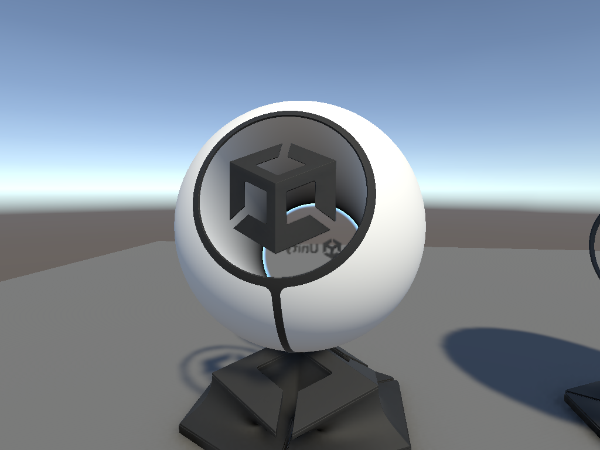
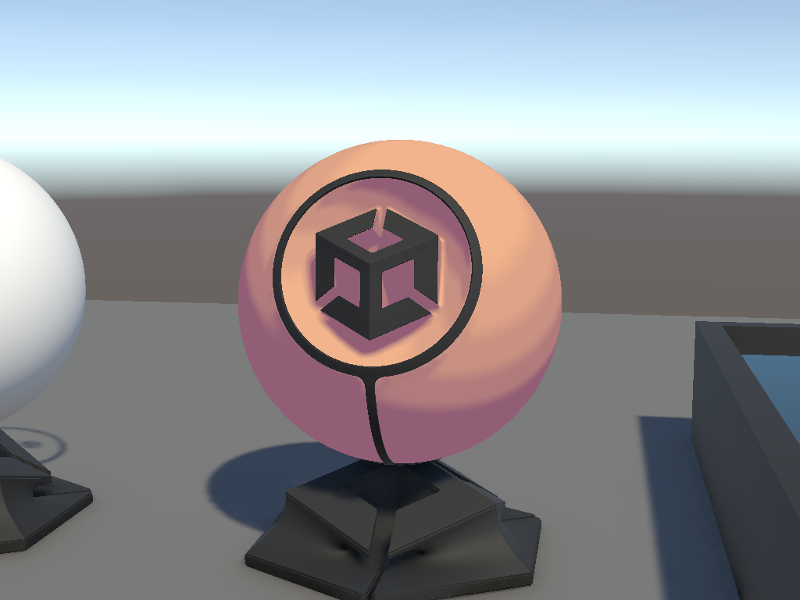
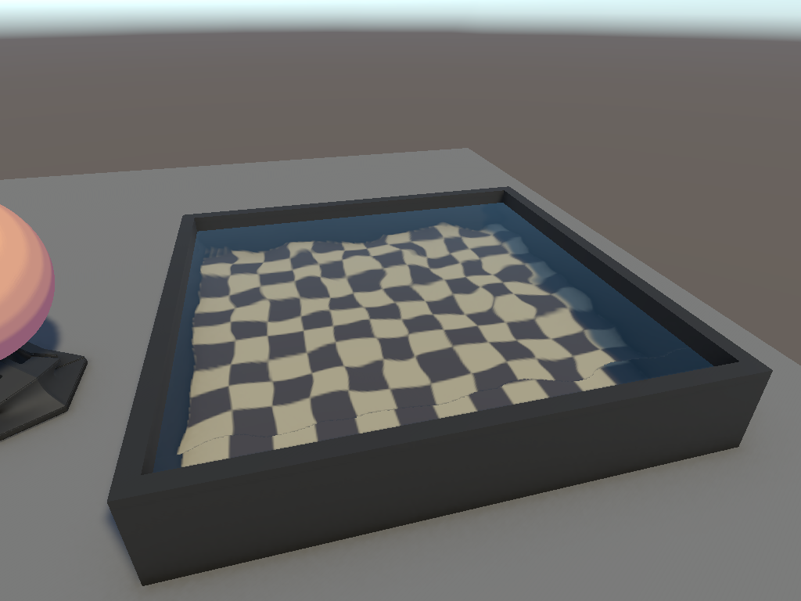

# 나만의 셰이더 제작 — 제출 문서

| # | 셰이더 | 파일 | 확인 위치 | 핵심 기법 |
| --- | --- | --- | --- | --- |
| 1 | InteriorRefractionHole | `Assets/02. MyShaders/01_InteriorRefractionHole/InteriorRefractionHole.shader` | `Study Shader` 씬 `ShaderBall_1` | 인테리어 매핑(광선-원통 교차) + 씬 컬러 |
| 2 | ToonDetailByDistance | `Assets/02. MyShaders/02_ToonDetailByDistance/ToonDetailByDistance.shader` | `Study Shader` 씬 `ShaderBall_2` | 램프 툰 조명 + 카메라 거리별 스타일 변화 |
| 3 | NoiseWater | `Assets/02. MyShaders/03_NoiseWater/NoiseWater.shader` | `Study Shader` 씬 `ShaderBalls/WaterPool` | 물결 수면(정점 변형) + 노이즈 일렁임(화면 굴절) |

모든 셰이더는 HLSL(`.shader`)로 작성했고, 경로는 `Shader "MyShaders/<이름>"` 형식입니다.

---

## 1. InteriorRefractionHole — 셰이더볼에 뚫린 원형 구멍

*이름: Interior(인테리어 매핑) + Refraction(씬 컬러 굴절 유리) + Hole(구멍)*

### 한 줄 요약
메시는 매끈한 구 그대로인데, 픽셀마다 "가운데에 원통 구멍이 뚫려 있다"고 가정하고 계산해서 구멍 안쪽 벽과 구멍 너머 풍경이 보이게 한다.

### 참고한 갤러리 표본
- **인테리어 매핑** (`interior-room-mapping`): 가상의 방과 시선을 교차시키는 구조
- **씬 컬러 굴절 유리** (`screen-refraction-glass`): 물체 뒤의 화면을 읽어서 칠하는 방법

### 동작 원리

#### (1) 먼저 이해한 것: 갤러리의 인테리어 매핑
- 준비물로 방을 정면에서 찍은 듯한 **이미지 한 장**이 있다. 가운데 절반 크기 사각형이 뒷벽이고, 그 둘레의 사다리꼴 네 개가 상하좌우 벽이다.
- 창문 칸마다 그 뒤에 **가상의 상자(방)** 가 있다고 두고, 카메라에서 픽셀로 오는 **시선**을 상자 안으로 연장한다. (법선이 아니라 시선이어야 시점에 따라 보이는 곳이 바뀐다.)
- 옆벽, 천장/바닥, 뒷벽까지의 거리를 각각 1차식으로 구하고, 가장 작은 값(`min`)이 시선이 처음 닿는 면이다.
- 닿은 지점을 `q = xy / (1 + 깊이)`로 이미지 좌표로 바꿔서 색을 읽는다. 이미지에 "여기는 바닥" 같은 태그가 있는 게 아니라, **이미지 한 장을 잘라서 펴 붙이듯** 정해진 영역을 각 면에 나눠 주는 방식이다. 그래서 이미지는 정해진 구도를 지켜야 하고, 구도가 다른 그림을 넣으면 어색해진다.

#### (2) 내 셰이더로 바꾼 점: 상자 → 원통
- **방향**: 갤러리는 큐브의 법선으로 "어느 면인가"를 골랐지만, 셰이더볼은 구라서 법선이 픽셀마다 달라 구멍 방향이 하나로 모이지 않는다. 그래서 구멍 방향을 머티리얼 값(`_TubeAxis`)으로 고정했다.
- **칸**: 창문 칸 대신 구멍 하나. 단면에서 중심까지의 거리가 반지름보다 크면 구멍이 아닌 표면이라 흰색으로 칠한다.
- **벽**: 상자의 평평한 벽 4개 대신 **둥근 원통 벽 하나**. 평평한 벽은 "x = 1"처럼 좌표 하나만 보면 되어 1차식이지만, 원통 벽은 "중심에서 거리가 R"이라 `x² + y² = R²`로 제곱이 들어가서 **2차 방정식**이 된다. 답이 두 개 나오는데, 광선이 구멍 입구(원 안쪽)에서 출발하므로 하나는 뒤쪽(음수), 하나는 앞쪽(양수)이고, 앞쪽 답만 쓴다.
- **뒷벽 → 출구**: 갤러리의 뒷벽 자리를 **뚫린 출구**로 바꿨다. 입구가 구의 곡면이라 픽셀마다 시작 깊이가 다르므로, 출구는 물체 중심에서 `±Depth/2` 위치의 고정 평면으로 두고 거기까지의 거리를 따로 구한다.
- **벽 색**: 이미지 대신 흰색으로 고정. 대신 맞은 지점의 원통 법선으로 조명을 주고, 깊을수록 어둡게(깊이 어둡기 1 고정) 해서 입체감을 낸다.

#### (3) 출구: 굴절 유리 표본에서 가져온 부분
- URP는 불투명 물체를 다 그린 직후의 화면을 **Opaque Texture**로 복사해 둔다. 이 셰이더는 Transparent 큐라서 그 뒤에 그려지고, 그래서 그 화면에는 셰이더볼 자신이 없고 뒤쪽 풍경만 있다.
- 출구 판정을 받은 픽셀은 **자기 화면 위치**의 Opaque Texture 색을 읽어 칠한다. 출구 지점은 카메라 → 픽셀 직선 위에 있으므로 화면에서는 같은 위치다. 유리 없는 구멍으로는 시선 그대로 뒤가 보이는 것과 같다.
- `_Refraction`을 올리면 표면 법선 방향으로 읽는 위치를 살짝 밀어서 렌즈처럼 휘어 보이게 할 수 있다.

#### 전체 흐름 (픽셀 하나 기준)
1. 구멍(원) 안인가? 아니면 흰 표면을 칠하고 끝
2. 카메라 → 픽셀 시선을 원통 안쪽으로 연장
3. 원통 벽까지(`tWall`, 2차식)와 출구까지(`tExit`, 1차식) 중 어디에 먼저 닿는가
4. 벽이면: 원통 법선으로 조명 + 깊이만큼 어둡게
5. 출구면: 화면 위치(+굴절)에서 뒤쪽 화면 색을 읽음 + 출구 테두리 발광

### 프로퍼티

| 프로퍼티 | 역할 | 현재 값 |
| --- | --- | --- |
| `_Radius` | 구멍 반지름 (오브젝트 단위) | 0.28 |
| `_Depth` | 터널 길이. 길수록 비스듬히 볼 때 벽이 더 많이 보인다 | 1 |
| `_TubeAxis` | 구멍이 뚫린 방향 (오브젝트 공간) | (0, 0.2, 0.5) |
| `_Refraction` | 출구 너머 화면을 휘게 하는 굴절 세기. 0이면 그냥 뚫린 구멍 | 0 |
| `_ExitRim` | 출구 테두리 발광 색 (HDR) | 하늘색 |

고정한 값: 표면색과 벽색은 흰색, 깊이 어둡기는 1, 출구 유리 틴트는 없음.

### 갤러리 대비 바꾸거나 더한 점
- 가상 도형을 **상자 → 원통**으로 바꿨다 (1차식 3개 + `min` → 2차 방정식 + 출구 비교).
- 방향을 법선 기반 면 선택이 아니라 **고정 축**으로 받아서, 구(셰이더볼)에도 구멍 하나가 일관되게 뚫리게 했다.
- 시작점이 곡면이라 출구를 **고정 평면까지의 거리**로 계산했다.
- 이미지방 대신 **흰색 + 원통 법선 조명 + 깊이 어둡기**로 벽을 칠했다.
- 인테리어 매핑의 **뒷벽 자리에 굴절 유리 표본의 씬 컬러 읽기를 붙여서** 뚫린 구멍으로 만들었다.

### 한계
- 뒤쪽 풍경은 화면 사진이라, 화면 밖에 있는 것은 보이지 않는다.
- 갤러리 굴절 유리에 있는 "앞 물체 끌림 방지"가 없어서, 굴절을 세게 주면 셰이더볼 앞에 있는 물체가 구멍 속에 비칠 수 있다.
- 구멍 방향과 비슷한 각도에서 볼수록 뚫려 보이고, 옆으로 비스듬히 볼수록 벽만 보인다 (기본 카메라 위치에서는 벽이 많이 보인다).

---

## 2. ToonDetailByDistance — 가까우면 실사, 멀면 툰

*Scene 뷰에서 볼에 가까이 가면 음영이 부드러워지고, 멀어지면 띠가 딱 끊긴다.*

### 한 줄 요약
램프 툰 조명의 "띠 수"와 "경계 부드러움"을 카메라 거리로 조절해서, 가까우면 부드러운 실사풍 음영, 멀면 딱 끊기는 툰 음영이 되게 한다.

### 참고한 갤러리 표본
- **램프 툰 조명** (`toon-ramp-lit`): 밝기(`dot(N, L)`)를 몇 개의 띠로 끊는 계산(`toonBands`)을 그대로 가져왔다.

### 아이디어
갤러리 예시에서 띠 수와 경계 부드러움을 가장 높게 두면, 띠 사이가 이어져서 툰보다 실사 느낌이 강해진다. 그래서 이 두 값을 **거리에 따라** 바꾸면, 가까이서는 실사, 멀리서는 툰이 된다. 최적화에서 멀리 있는 물체의 메시나 머티리얼을 단순화하는 **LOD**에서 착안했다.

### 동작 원리
1. **거리 → 비율**: 카메라와 물체 중심 사이의 거리를 재서, `Near Distance`에서 0, `Far Distance`에서 1이 되는 비율(`farT`)로 바꾼다. 픽셀마다가 아니라 물체 중심 하나로 재서 볼 전체가 같은 스타일이 된다.
2. **비율 → 스타일 값**: 띠 수와 경계 부드러움을 가까울 때 값과 멀 때 값 사이에서 `lerp`로 고른다.
3. **밝기**: 빛을 정면으로 받는 곳이 1, 빛과 직각인 곳이 0인 `dot(N, L)`에 받는 그림자를 곱한다.
4. **띠로 끊기**: 밝기를 정해진 띠 수로 계단처럼 끊는다. 경계 부드러움이 크면 계단 사이가 매끈하게 이어지고(실사), 작으면 딱 끊긴다(툰).
5. **색**: 띠 값으로 그늘 색과 기본 색 사이를 골라 칠한다. 검게 어둡히지 않고 색조를 바꿔서 만화풍 그늘이 된다.

### 프로퍼티

| 프로퍼티 | 역할 | 기본값 |
| --- | --- | --- |
| `_BaseColor` | 빛 받는 쪽 색 | 살구색 |
| `_ShadeColor` | 그늘 색 (기본 색에 곱함) | 보라색 |
| `_NearDist` / `_FarDist` | 이 거리 사이에서 스타일이 바뀐다 | 1.5 / 6 |
| `_NearBands` / `_NearSoftness` | 가까울 때 띠 수 / 경계 부드러움 (실사) | 8 / 0.5 |
| `_FarBands` / `_FarSoftness` | 멀 때 띠 수 / 경계 부드러움 (툰) | 2 / 0.02 |

### 갤러리 대비 바꾸거나 더한 점
- 띠 수와 경계 부드러움을 고정값 하나가 아니라 **가까울 때 / 멀 때 두 벌**로 나누고, **카메라 거리로 보간**하는 계산을 더했다.
- 가까울 때 실사 느낌을 더 내도록 띠 수 상한을 5에서 **8**로 늘렸다.
- 띠 수는 정수로 반올림해서 거리에 따라 **단계적으로** 바뀐다. 실제 LOD가 단계별로 바뀌는 것과 닮게 일부러 남겼고, 경계 부드러움은 연속으로 바뀌어 전환이 덜 튄다.
- 갤러리의 그늘 넓이(`_ShadeShift`)와 빛 색조 처리는 빼서 단순하게 했다.

### 한계
- LOD와 **발상**은 같지만 **연산량은 줄지 않는다.** 거리와 상관없이 같은 셰이더가 같은 계산을 한다. 실제 최적화라면 LOD Group으로 멀리서는 더 싼 셰이더나 메시로 바꿔 끼워야 한다.
- 띠 수가 바뀌는 거리에서 음영이 한 단계씩 툭 바뀐다.

## 3. NoiseWater — 바닥이 일렁여 보이는 물

*기본값은 파도 높이 0이라 노이즈 일렁임만 보인다. `Wave Height`를 0.008 정도로 올리면 수면이 출렁인다.*

### 한 줄 요약
갤러리 물결 수면에 클로킹 투명화의 "일렁이는 몸"을 붙여서, 물 아래 바닥이 흐르는 노이즈와 파도를 따라 일렁여 보이게 한 물 셰이더.

### 참고한 갤러리 표본
- **물결 수면** (`water-wave-surface`): 사인파 3개로 정점을 움직이고, 기울기로 법선을 다시 구해 프레넬과 반사광을 칠하는 구조
- **클로킹 투명화** (`cloak-refraction-shimmer`, 일렁이는 몸 프리셋): 흐르는 노이즈로 뒤 화면을 비틀어 읽는 방법과 앞 물체 끌림 방지

### 아이디어
물결 수면은 파도의 높낮이는 있지만 물 아래가 반투명으로 그대로 비칠 뿐 일렁이지 않는다. 은신의 일렁이는 효과를 물 아래에 붙이면 실제 물처럼 바닥이 흔들려 보인다. 노이즈 효과를 한눈에 볼 수 있도록 파도는 머티리얼 값으로만 켜게 하고 기본값은 꺼 두었다.

### 동작 원리
1. **파도 높이 (정점 단계)**: 방향, 파장, 높이가 다른 사인파 3개를 더한 값만큼 평면의 정점을 위아래로 움직인다. 하나만 쓰면 곧은 줄무늬가 되어서 엇갈린 3개를 더한다. (기본값은 높이 0이라 평평하다.)
2. **법선 (픽셀 단계)**: 정점을 움직여도 메시의 법선은 위를 향한 그대로라, 같은 식의 기울기로 `(-x 기울기, 1, -z 기울기)` 법선을 다시 구한다.
3. **프레넬과 반사광**: 내려다볼수록 물속이 보이고 비스듬할수록 하늘빛이 비친다(프레넬). 빛과 시선의 중간 방향이 법선과 맞는 곳만 반짝인다(Blinn-Phong).
4. **물 아래 일렁임 (클로킹에서 가져온 부분)**: 물은 Transparent 큐라서 그 전에 찍힌 화면(Opaque Texture)에는 바닥만 있다. 그 화면을 읽을 때, 파도 법선의 화면 방향 성분과 시간에 따라 흐르는 노이즈만큼 읽는 위치를 옮겨서 바닥이 일렁여 보이게 한다.
   - 미는 길이를 최대값으로 묶고, 화면비만큼 가로를 줄인다.
   - 밀린 자리의 깊이가 수면보다 앞(예: 수조 테두리)이면 밀지 않은 자리를 읽어서, 물 밖 물체가 물속에 비쳐 들어오지 않게 한다.
   - 읽어 온 바닥 색을 물빛과 섞어 탁하게 한다.
5. **최종**: 프레넬 비율로 일렁이는 바닥과 하늘빛을 섞고 반사광을 더한다.

### 프로퍼티

| 프로퍼티 | 역할 | 기본값 |
| --- | --- | --- |
| `_WaveHeight` | 파도 높이. 0이면 파도 없음 | 0 |
| `_WaveLength` / `_WaveSpeed` / `_WaveAngle` | 첫 파도의 파장, 속도, 방향 (나머지 둘은 비율로 따라감) | 0.45 / 0.25 / 225 (머티리얼) |
| `_DeepColor` / `_SkyColor` | 물빛 / 비스듬히 볼 때 비치는 하늘빛 | 짙은 파랑 / 하늘색 |
| `_Murk` | 물 아래 바닥을 물빛으로 탁하게 하는 정도 | 0.35 |
| `_SpecStrength` / `_SpecPower` | 반짝임 세기 / 날카로움 | 1.2 / 200 |
| `_Refraction` | 물 아래를 비트는 세기 | 0.06 |
| `_NoiseScale` / `_NoiseStrength` / `_FlowSpeed` | 일렁임 노이즈의 크기 / 세기 / 흐르는 속도 | 8 / 0.5 / 0.4 (머티리얼) |

### 갤러리 대비 바꾸거나 더한 점
- 물결 수면의 **반투명 섞기를 없애고**, 클로킹 방식으로 **물 아래 화면을 직접 비틀어 읽게** 바꿨다.
- 비트는 방향에 몸의 법선 대신 **파도 법선**을 써서, 파도를 켜면 일렁임이 물결과 맞물린다.
- 물 아래 색을 물빛과 섞는 **탁도**를 더했다.
- **파도 기본값을 0**으로 두어 노이즈 일렁임만 따로 확인할 수 있게 했다.
- 수조 크기에 맞춘 파도 값과 전용 평면 메시(70칸)를 만들었다.

### 한계
- 물 아래는 화면 사진이라, 화면 밖에 있는 바닥은 비치지 않는다.
- 파도는 사인파 3개의 합이라 같은 무늬가 일정 주기로 반복된다.
- Scene 뷰에서 움직임을 보려면 Effects 메뉴의 Always Refresh를 켜거나 Play 해야 한다.
